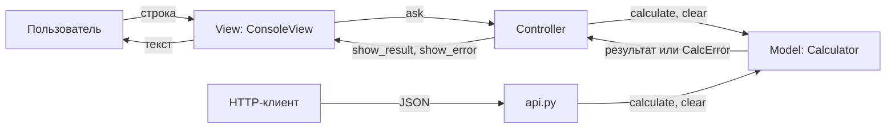

# Архитектура MVC калькулятора

MVC делит приложение на три части с разной ответственностью.

| Часть | Файл | За что отвечает | О чём не знает |
|---|---|---|---|
| Model | `mvc_calc/model.py` | разбор и вычисление выражений, история, ошибки | о консоли, HTTP и JSON |
| View | `mvc_calc/view.py` | ввод строки и вывод результатов | как вычисляется выражение |
| Controller | `mvc_calc/controller.py` | разбор команд, вызов модели, выбор метода представления | как хранится история и как выглядит вывод |

## Что происходит при вводе `2+3*4`

1. `ConsoleView.ask` возвращает введённую строку.
2. `Controller.handle` видит, что это не команда, и вызывает
   `Calculator.calculate`.
3. Модель разбирает выражение, вычисляет 14 и добавляет запись в историю.
4. Контроллер вызывает `ConsoleView.show_result`.
5. При ошибке модель выбрасывает `CalcError`, контроллер передаёт её
   текст в `show_error`.

## Что это даёт

- Модель проверяется тестами без ввода и вывода.
- Контроллер проверяется с поддельным представлением `FakeView`.
- REST API использует ту же модель: для нового интерфейса вычисления
  менять не пришлось. В `api.py` роль контроллера выполняют обработчики
  FastAPI, роль представления — модели Pydantic, превращающие результат
  в JSON.
- Консоль можно заменить окном Tkinter, написав новый класс с теми же
  методами `show_…`.
